# Governance in EnviroSense: a guided tour (27 November 2026)

Screenshots taken from the running app on the VM, signed in with the demo accounts (administrator, approving officer, analyst).
Each section says **what the screen shows**, **what is enforced and where** (database, server or screen), and **which framework
requirement it answers**. The step-by-step journeys and flow diagrams are in `governance_workflows.md`.

Where a rule is held by the database (a trigger or a constraint), it holds even if someone calls the server directly or edits the
screen. Where it is held by the server, the API refuses the request and the screen only explains why.

---

## 1. Compliance: one place that says what is met, and proves it
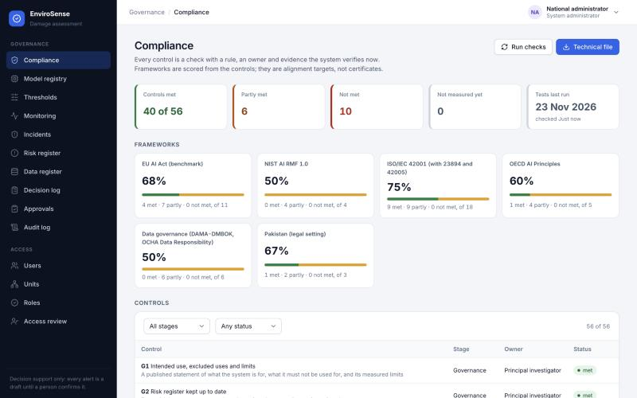

- **What it shows:** 56 controls across 13 stages, from training data to incidents. Each has a rule, an owner and evidence. Today
  40 are met, 6 are partly met and 10 are not met. The six frameworks are scored **from** the controls, so a framework score can only
  rise when real evidence appears.
- **How evidence is checked:** each control names its evidence type. A *test* is a named automated test that must have passed in
  the last test run. *Live* is a check run now against the database (for example, the audit chain verifies). A *file* must exist,
  or must contain a required text. A *record* must exist in a governance table (for example, an access review). Nobody ticks a box.
- **Technical file:** generated from the same records, in the order of EU AI Act Annex IV.
- **Frameworks:** EU AI Act Art. 11 (technical documentation) and Art. 17 (quality management); NIST AI RMF GOVERN 1;
  ISO/IEC 42001 clause 9 (performance evaluation).

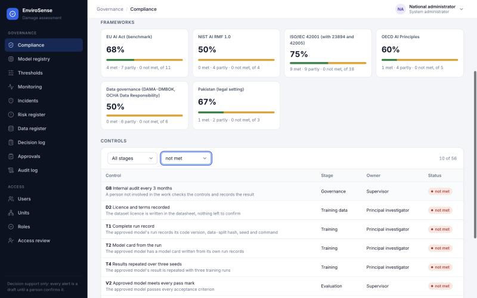

**The 10 "not met" controls are genuine gaps, and the page shows them.** Each needs work done by people or by training runs, not more
code:
- an internal audit (G8);
- the xBD licence in the datasheet (D2);
- a complete run record and a model card for the approved model (T1, T2);
- three seeds (T4);
- every acceptance criterion passed (V2);
- the oversight test, the incident drill and the first access review.

## 2. Model registry and release gate: no model goes live on a good feeling
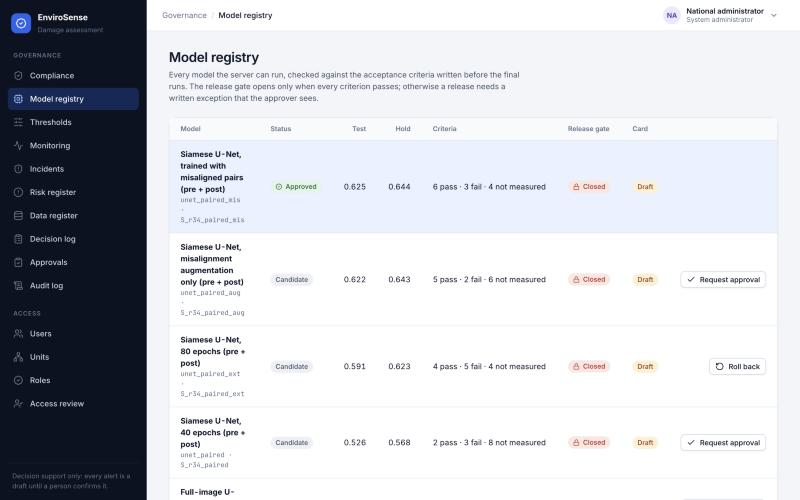
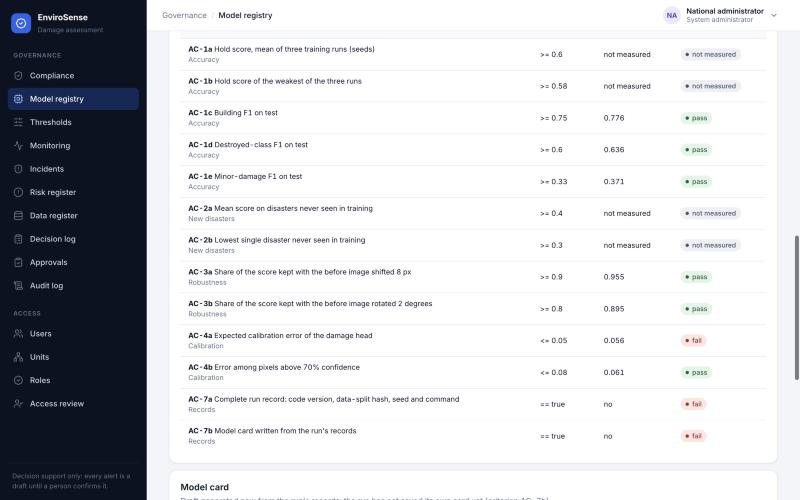

- **What it shows:** every model the server can run, scored against acceptance criteria that were **written on 3 November, before the
  final runs**. The approved model (E15, `unet_paired_mis`) has 6 passes, 3 fails and 4 not measured:
  - **Fails:**
    - AC-4a: calibration error 0.056, against a limit of 0.05.
    - AC-7a and AC-7b: the run predates the split hash and the model card.
  - **Not measured:**
    - AC-1a and AC-1b: three seeds.
    - AC-2a and AC-2b: unseen disasters.

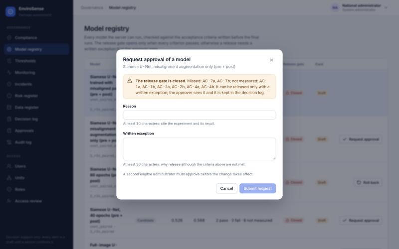

- **Enforced (server):** a request to approve a model whose gate is closed is refused unless it carries a **written exception of at least
  20 characters**. The approver sees the exception, and it is stored in the decision log.
- **Enforced (database):** a model change takes effect only when a **second administrator** approves it. The same person cannot ask
  and approve.
- **Frameworks:**
  - EU AI Act Art. 15 (accuracy, robustness) and Art. 9 (testing against defined metrics before release);
  - NIST MEASURE 2.3 and 2.5;
  - ISO/IEC 42001 A.6 (AI system life cycle: verification and release).

## 3. Thresholds: every number that changes behaviour is versioned
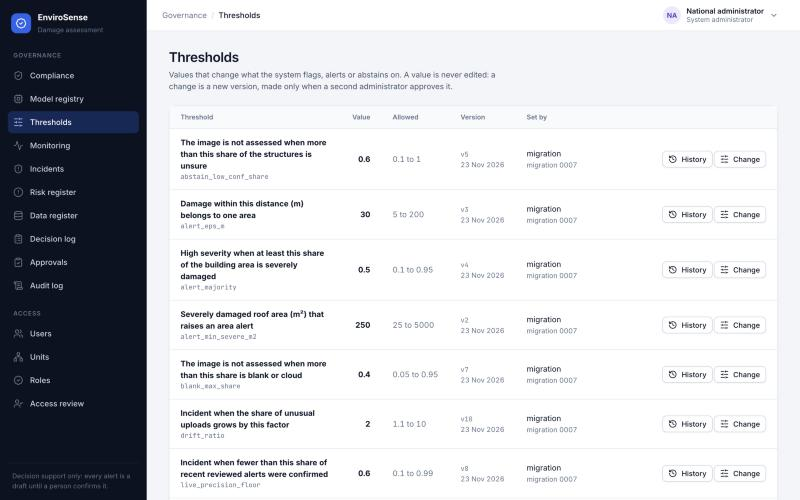
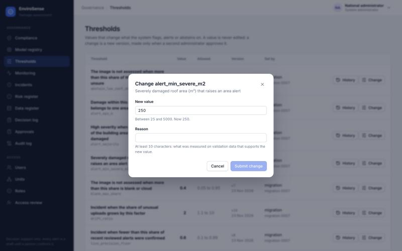

- **What it shows:** the 10 values that decide what is flagged, alerted, abstained on or raised as an incident. Each shows its allowed
  range, its version and who set it. Examples:
  - 250 m² of severe roof raises an alert;
  - 30 m grouping distance;
  - not assessed when more than 60% of structures are unsure;
  - an incident when live precision falls below 0.6.
- **Enforced (database):** rows in `sem.thresholds` cannot be updated or deleted (trigger). A change is a new version, through a
  two-person approval, with a reason ("what was measured on validation data that supports the new value"). Values outside the range
  are refused.
- **Enforced (server):** every new assessment stores the `rule_version` it was made with. An alert can always be traced to the rule
  that made it.
- **Frameworks:** EU AI Act Art. 12 (record-keeping) and Art. 17 (change control); ISO/IEC 42001 clause 8.1 (operational control);
  NIST MANAGE 1.

## 4. Image intake: the right to use the image, and no personal metadata
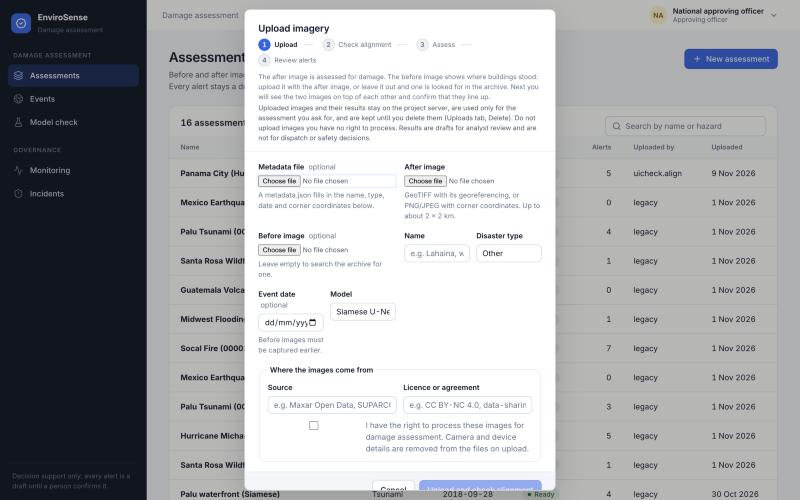

- **What it shows:** before an upload, the analyst must give the **source**, the **licence or agreement**, and confirm the right to
  process the images.
- **Enforced (server):** an upload without these three is refused. Camera and device metadata (EXIF/XMP) are removed from JPEG and PNG
  at byte level; the georeference is kept. Six image statistics (brightness, contrast, saturation, sharpness, blank share, cloud share)
  are compared with xBD's 1st–99th percentile. More than two outside the range marks the image *unusual*.
- **Abstention (server):** the area is shown as **"Not assessed: needs a person"** and **no alert is made** when any of these hold:
  - the image is too coarse;
  - the before image postdates the event;
  - more than 40% of the image is blank or cloud;
  - the image is unusual;
  - more than 60% of structures are below 70% confidence.

  An empty map would read as "no damage"; abstaining avoids that.
- **Frameworks:**
  - EU AI Act Art. 10 (data governance) and Art. 15 (resilience to inputs outside the intended range);
  - OCHA Data Responsibility; DAMA-DMBOK (lineage, licence);
  - Pakistan PECA 2016 (lawful processing).

## 5. Human review: nobody confirms their own proposal
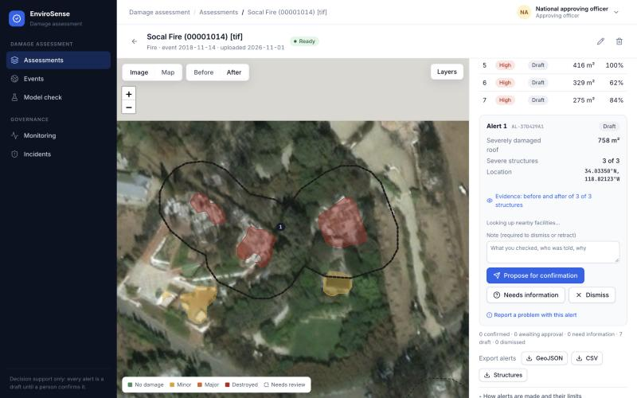

- **What it shows:** every alert starts as a **Draft**. The analyst can propose it for confirmation, mark it as needing information, or
  dismiss it with a note. An **approving officer, a different person**, confirms or retracts it. The evidence (before and after crops
  of each severe structure) is one click away.
- **Enforced (database):** four-eyes. The person who proposed an alert cannot confirm it.
- **Enforced (server):**
  - a dismissal or retraction needs a note;
  - a **retraction opens an incident** automatically;
  - each decision records how long the reviewer took and whether they opened the evidence. Confirmations made in under 5 seconds, or
    without opening the evidence, count as possible **rubber stamps** on the Monitoring page.
- **Frameworks:** EU AI Act Art. 14 (human oversight, including automation bias, Art. 14(4)(b)); NIST MANAGE 2.4;
  OECD 1.2 (human-centred values) and 1.4 (robustness and safety).

## 6. Monitoring and incidents: after release, is it still doing what it was approved to do?
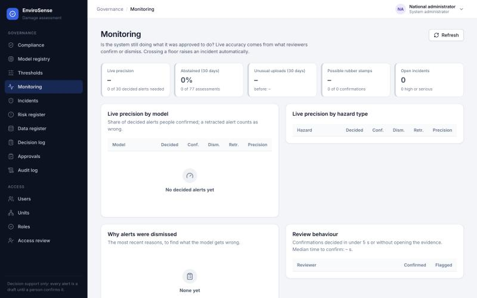
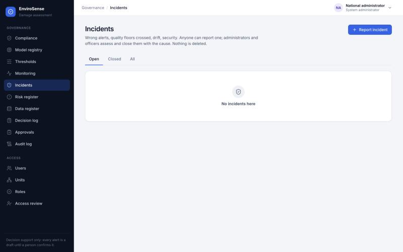

- **What it shows:**
  - live precision (confirmed ÷ decided alerts, per model and hazard);
  - the abstention share (0% of 77 assessments);
  - the unusual-upload share and its drift;
  - possible rubber stamps;
  - open incidents.
- **Enforced (server):** at start-up and on refresh, the monitor opens an incident (without duplicates) when any of these happen:
  - live precision over the last 30 decided alerts falls below 0.6;
  - unusual uploads double;
  - the audit chain breaks.

  Incident events cannot be edited or deleted (trigger). A serious incident must reach the supervisor within 24 hours.
- **Honest note:** both pages are empty because **no alert has been decided yet on this database**. They will fill during the
  oversight test (planned control H4), when reviewers decide real alerts, some of them planted as false.
- **Frameworks:** EU AI Act Art. 72 (post-market monitoring) and Art. 73 (serious incidents); NIST MEASURE 3 and MANAGE 4;
  ISO/IEC 42001 clause 10 (nonconformity and corrective action).

## 7. Risk register, data register, decision log
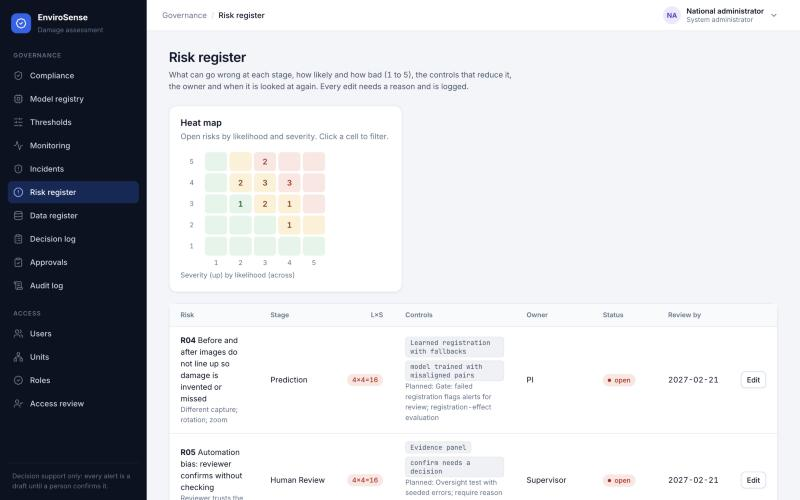
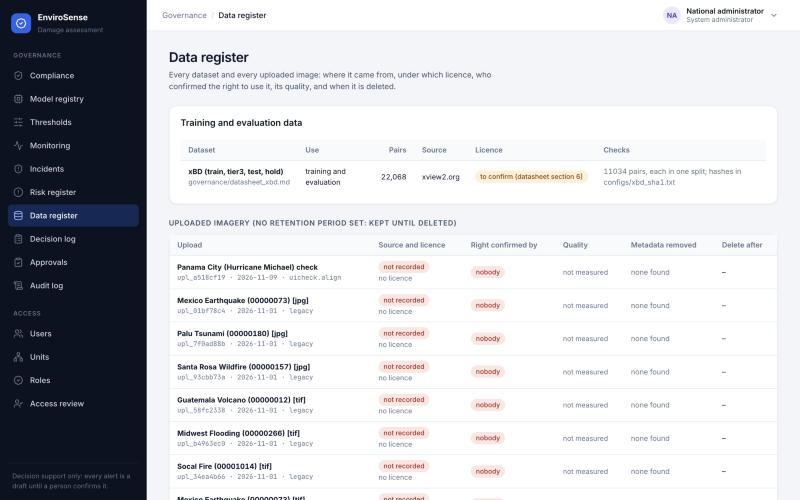
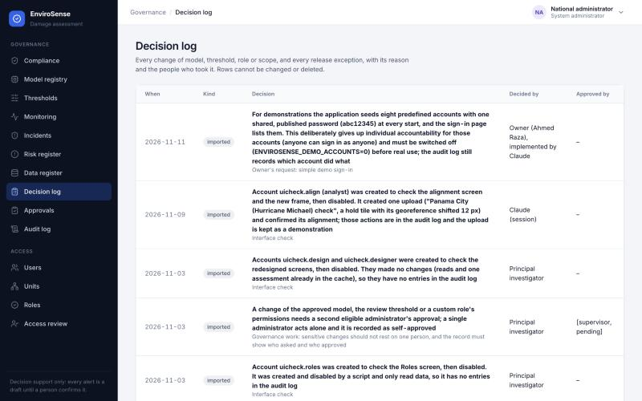

- **Risk register:** each risk has a likelihood and severity (1–5), a heat map, controls (in place and planned), an owner and a review
  date. Every edit needs a reason and is audited. *EU AI Act Art. 9; ISO/IEC 23894; NIST MAP 4–5.*
- **Data register:** the training dataset (22,068 xBD pairs, hashes in `configs/xbd_sha1.txt`, **licence still "to confirm"**) and
  every upload with its source, licence, who confirmed the right, quality, removed metadata and deletion date. The existing uploads
  show "not recorded" honestly: they predate the rule, and new uploads cannot be made without it. *EU AI Act Art. 10; DAMA-DMBOK;
  OCHA.*
- **Decision log:** every change of model, threshold, role or scope, and every release exception, with its reason and who decided and
  approved it. Rows cannot be changed or deleted (trigger). *ISO/IEC 42001 clause 7.5 (documented information); NIST GOVERN 1.4.*

## 8. Audit log and approvals: everything is on the record
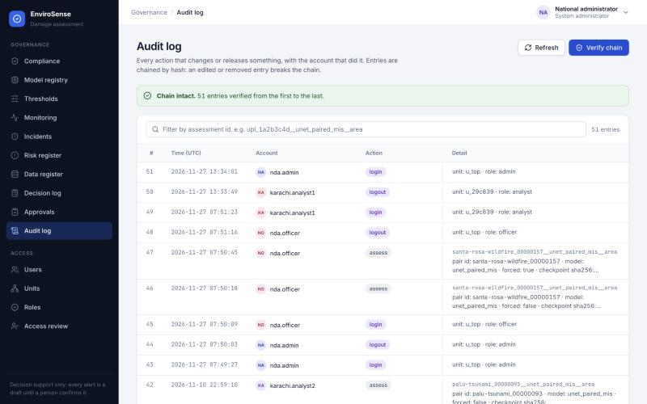
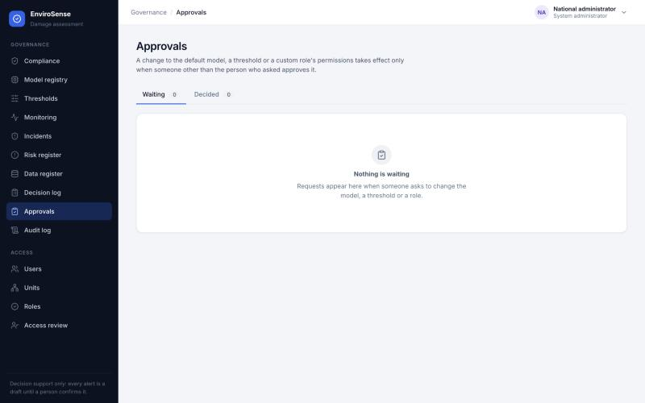

- **Audit log:** each entry is hash-chained to the one before. **Verify chain** recomputes all 51 entries: *Chain intact*. Editing or
  removing any entry breaks the chain from that point. Each assessment entry carries the model, the checkpoint SHA-256 and the input.
  *EU AI Act Art. 12; ISO/IEC 42001 A.6.2.8 (event logs).*
- **Approvals:** the queue of two-person requests (model, threshold, role). Empty today.

## 9. Access: least privilege, reviewed
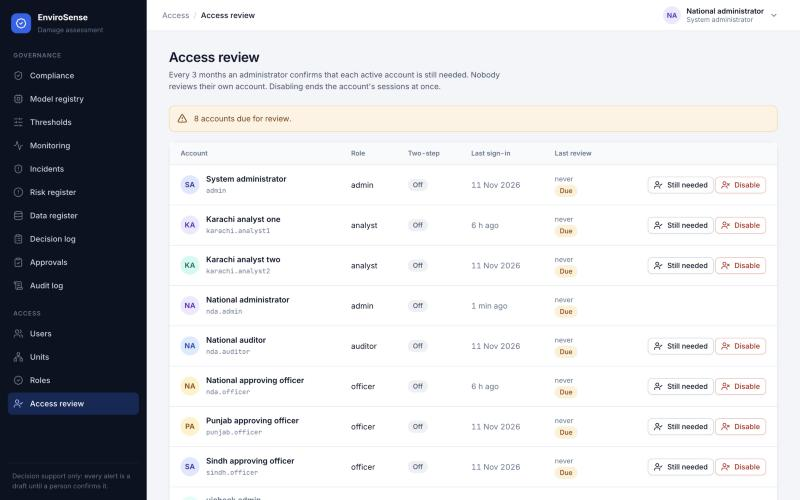
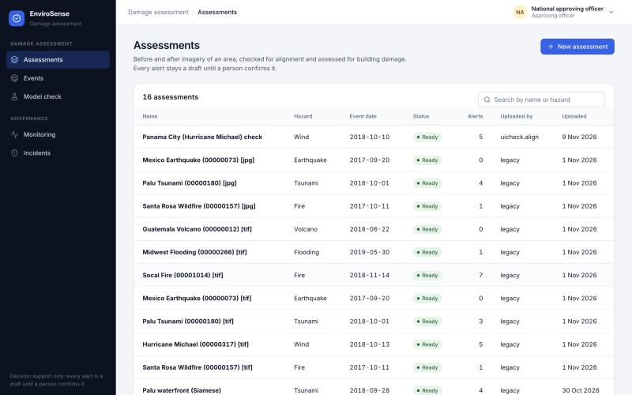
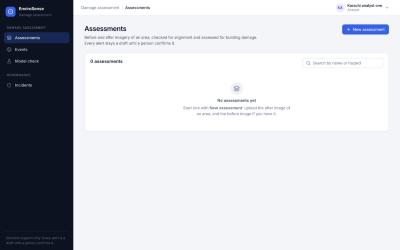

- **Access review:** every 3 months an administrator confirms that each account is still needed, or disables it. **Nobody reviews their
  own account:** the signed-in administrator's row has no buttons. The review also shows two-step sign-in status, which today is off
  for all 8 demo accounts.
- **Separation of duties (server, deny by default):**
  - the administrator sees governance and access but no imagery or alerts;
  - the officer sees assessments, monitoring and incidents;
  - the Karachi analyst sees only their own unit's assessments and has no governance pages.
- **Two-step sign-in (TOTP, RFC 6238):** available to every account. It is *expected* for anyone who can manage users, approve or
  export. Control F6 stays "not met" until those accounts turn it on; it is not forced, so nobody is locked out. A lost phone is
  handled by an administrator password reset, which clears two-step and is audited.
- **Frameworks:** ISO/IEC 42001 A.3 (roles and responsibilities); PECA 2016 (unauthorised access); NIST GOVERN 2.

---

## How this was verified
- **Automated tests:** 106 tests on the VM (`TORCH_DISABLE_NATIVE_JIT=1 .venv/bin/python -m pytest app/tests`). 21 of them are new
  governance-module tests. They include:
  - an upload without rights is refused;
  - metadata is stripped and the georeference kept;
  - abstention makes no alert;
  - the gate refuses without an exception;
  - thresholds, decisions and incident events refuse UPDATE and DELETE;
  - the precision floor opens one incident, not one per check;
  - the report needs the export permission and is audited;
  - two-step sign-in and its reset.
- **Real database:** backed up (`runs/backups/envirosense_20261123_101138.dump`) and migrated to 0007. The screenshots above are of that
  database.
- **Measured side effect of the blank or cloud check:** 5 of 400 held-out xBD training images would have been refused (1.25%).

## What is not built in code
- A daily copy of the audit-chain head kept outside the database. It would detect someone with database-admin rights rewriting the
  whole log.
- HTTPS inside the app. Today access is only through the SSH tunnel.
