# Governance workflows: journeys, decisions and records, stage by stage

How EnviroSense behaves at each stage of its life cycle, written so that every stage can be drawn and checked. For each stage:

- **Who**: the people (roles) and the system parts involved
- **Trigger**: what starts the workflow
- **Journey**: the steps, in order
- **Decisions**: every point where the flow branches, with the exact rule (the values are the thresholds in force; their versions are on the Thresholds page)
- **Records**: what is written, and where
- **Screens**: where it happens in the application
- **Controls and frameworks**: the controls of `governance/controls.json` it carries, and the framework requirements those map to

The diagrams are Mermaid (they render on GitHub and in most Markdown viewers). Shapes: rectangles are steps, diamonds are decisions, rounded boxes are
outcomes, cylinders are records.

Roles used throughout: **Analyst** (assesses, uploads, proposes, dismisses), **Approving officer** (also confirms, retracts, exports), **Administrator**
(accounts, model and threshold changes, incidents, risks; no imagery or alerts), **Auditor** (reads everything on the record, changes nothing, no imagery),
**Principal investigator** (trains and evaluates models), **Supervisor** (independent reviewer and release approver), **System** (automatic checks).

---

## 0. The life cycle at a glance

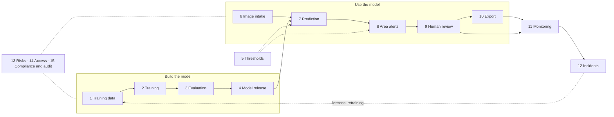

| Stage | Governance module | Key rule | Main controls |
| --- | --- | --- | --- |
| 1 Training data | Data governance | Hashes verified, licence recorded, no pair in two splits | D1–D4 |
| 2 Training | Model governance | Complete run record, model card from the run, memory guard | T1–T4 |
| 3 Evaluation | Validation and assurance | Pass marks written before the results | V1–V4 |
| 4 Model release | Change control | Release gate, two people, rollback | R1–R4 |
| 5 Thresholds | Change control | Versioned, two people, never edited | A2 |
| 6 Image intake | Data governance | Rights, privacy, quality, a person confirms the alignment | I1–I5 |
| 7 Prediction | Runtime safeguards | Abstain instead of guess, provenance on every result | P1–P4 |
| 8 Area alerts | Transparency | Drafts only, stated and versioned rule | A1–A3 |
| 9 Human review | Human oversight | Four-eyes, reasons, rubber-stamp measure | H1–H4 |
| 10 Export | Controlled sharing | Export right, labelled, logged, own unit | E1–E3 |
| 11 Monitoring | Monitoring | Live precision, drift, behaviour, chain; floors raise incidents | M1, M2 |
| 12 Incidents | Incident management | Open, assess, close with cause; serious within 24 h | N1–N4 |
| 13–15 | Governance layer and foundation | Risks, access, audit, compliance | G1–G8, F1–F7 |

---

## 1. Training data

**Who:** Principal investigator; System (scripts). **Trigger:** a dataset is added or refreshed.

**Journey**
1. Download the archives from the provider (xBD: xview2.org) into `data/xbd/_archives/`.
2. Verify every archive against its published hash (`scripts/verify_xbd.sh`, hashes in `configs/xbd_sha1.txt`).
3. Unpack; make the masks tier3 lacks (`src/make_targets.py`).
4. Audit the data (`src/audit_xbd.py`): counts, classes, events, geometry.
5. Record the licence and terms in the datasheet (`governance/datasheet_xbd.md`, section 6).
6. Freeze the split: every pair assigned to train, validation or test in `configs/pair_splits.csv`; check that no pair is in two splits.

**Decisions**

| Decision | Rule | Yes | No |
| --- | --- | --- | --- |
| Hash matches? | SHA-1 of each archive equals the published one | Unpack | Do not use; download again |
| Licence recorded? | Datasheet section 6 has no "[to confirm]" | Control D2 met | D2 not met; the release gate's records stay incomplete |
| Leakage-free? | No `pair_id` in more than one split | Use the split | Fix the split before any training |

**Records:** `configs/xbd_sha1.txt`, `reports/audit_xbd.md`, `governance/datasheet_xbd.md`, `configs/pair_splits.csv` (its SHA-256 goes into every run record).
**Screens:** Data register (datasets), Compliance (D1–D4). **Controls:** D1, D2, D3, D4. **Frameworks:** EU Art. 10; NIST Map; ISO 42001 A.7; DAMA quality, metadata.

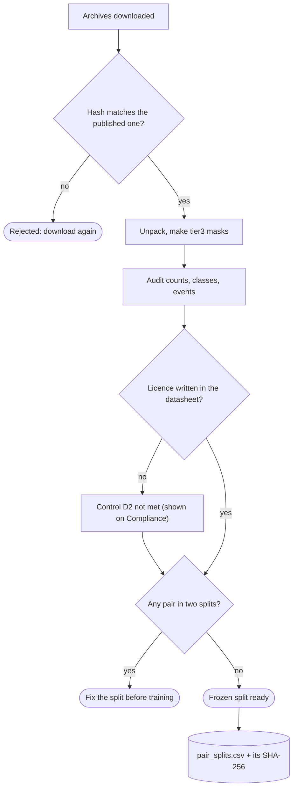

---

## 2. Training

**Who:** Principal investigator; System (training script). **Trigger:** a new experiment is planned.

**Journey**
1. Write the experiment entry first (why, setup, expected result) in `reports/experiment_log.md`.
2. Run `src/seg_benchmark.py` (plain script, not a notebook) with a GPU memory cap (60%) and the free-memory guard (`--min-free-ram-gb`).
3. The run writes `config.json` with its settings, code version (git commit, dirty flag), data-split hash, seed and exact command.
4. After training it scores test and hold, then writes its own model card (`src/model_card.py` → `runs/<run>/model_card.md`).
5. For a release candidate: repeat with three seeds (`seeds.json`), and the event-held-out cross-validation (`unseen_metrics.json`).

**Decisions**

| Decision | Rule | Outcome |
| --- | --- | --- |
| Free memory below the guard? | MemAvailable < `--min-free-ram-gb` (default 2 GB) every 200 steps | The run saves and stops itself |
| Run record complete? | `git_commit`, `splits_sha256`, `seed`, `command` all present | Criterion AC-7a passes; otherwise it fails and the release gate stays closed |
| Card saved? | `runs/<run>/model_card.md` exists | AC-7b passes; the registry otherwise shows a generated draft |

**Records:** `runs/<run>/config.json`, `log.jsonl`, `test_metrics.json`, `model_card.md`, `seeds.json`, `unseen_metrics.json`; `reports/experiment_log.md`.
**Screens:** Model registry (card, scorecard). **Controls:** T1–T4. **Frameworks:** EU Art. 11, 12, 15; NIST Measure; ISO 42001 A.4, A.6; DAMA lineage.

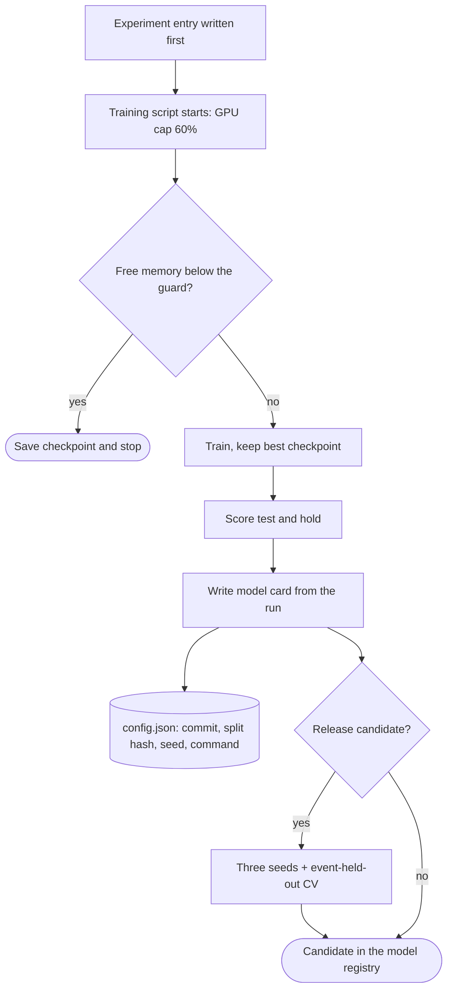

---

## 3. Evaluation (the scorecard)

**Who:** Principal investigator runs it; Supervisor reads it. **Trigger:** a candidate model appears in the registry.

**Journey**
1. The acceptance criteria were written before the final runs (`governance/acceptance_criteria.md`, machine-readable in `acceptance_criteria.json`).
2. The registry reads the candidate's own records and scores each criterion: **pass**, **fail** or **not measured**.
3. The supervisor reads the scorecard, not the code.

**Decisions (the pass marks)**

| ID | Criterion | Pass mark |
| --- | --- | --- |
| AC-1a, b | Hold score over three seeds: mean, weakest | ≥ 0.60, ≥ 0.58 |
| AC-1c, d, e | Building F1, destroyed F1, minor F1 on test | ≥ 0.75, ≥ 0.60, ≥ 0.33 |
| AC-2a, b | Disasters never seen in training: mean, lowest event | ≥ 0.40, ≥ 0.30 |
| AC-3a, b | Score kept with an 8 px shift, a 2° rotation of the before image | ≥ 90%, ≥ 80% |
| AC-4a, b | Calibration error; error above 70% confidence | ≤ 0.05, ≤ 0.08 |
| AC-7a, b | Complete run record; saved model card | yes, yes |

A criterion without data is **not measured**, which closes the gate as surely as a failure. The current approved model (E15) passes AC-1c, d, e,
AC-3a, b and AC-4b; it misses AC-4a (ECE 0.056), AC-7a (its run predates the split hash) and AC-7b (no saved model card); AC-1a, b and AC-2a, b are
not measured (one training run, no event-held-out test yet). It stays approved under the approval made before the gate existed; the next release
must pass the gate or carry a written exception.

**Records:** scorecard computed from the run files. **Screens:** Model registry. **Controls:** V1–V4. **Frameworks:** EU Art. 15; NIST Measure; ISO 42001 Cl. 8, A.6; OECD 1.4.

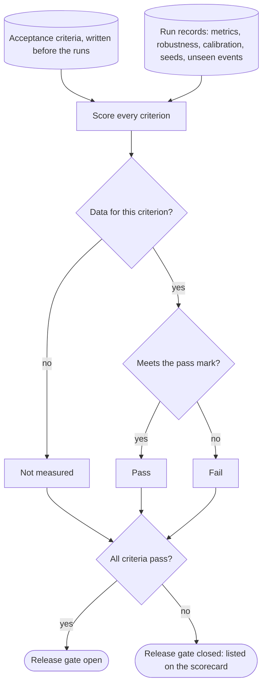

---

## 4. Model release (approval, exception, rollback)

**Who:** Administrator (requests), a second Administrator (approves), Supervisor (signs off in the decision log). **Trigger:** a better candidate, or a problem with the approved model (rollback).

**Journey**
1. On the Model registry an administrator selects a candidate and clicks **Request approval** (or **Roll back** on the previous model).
2. They give the reason (at least 10 characters). If the release gate is closed, they must also write an **exception** (at least 20 characters): why release although criteria are missed or unmeasured.
3. The request is filed; the requester cannot approve it.
4. A second eligible administrator sees it under **Approvals**, with the gate status and the exception, and approves (optional note) or rejects (reason required).
5. On approval the change is made in the same database transaction: the model becomes the approved default; the previous one stays available for rollback.
6. A decision row (`gov.decisions`, kind `model_release`) records both people, the reason and the exception; the audit log records it too.

**Decisions**

| Decision | Rule | Yes | No |
| --- | --- | --- | --- |
| Gate open? | Every acceptance criterion passes | Request needs only a reason | Request needs a written exception of ≥ 20 characters, or it is refused |
| Another eligible approver exists? | An active user, other than the requester, holds `model_approve` | Request waits for them (expires after 7 days) | Applied at once, marked self-approved (a new installation) |
| Approver agrees? | Second person's decision | Applied in the same transaction | Rejected with a reason; nothing changes |
| Still applicable at decision time? | The model can still be loaded | Applied | Request fails; nothing changes |

**Records:** `wf.approval_requests` (fixed once decided), `sem.model_versions` (one approved row), `gov.decisions`, `audit.log`, `governance/decision_log.md`.
**Screens:** Model registry, Approvals, Decision log. **Controls:** R1–R4, P4. **Frameworks:** EU Art. 9, 17; NIST Govern, Manage; ISO 42001 Cl. 8, A.3, A.6.

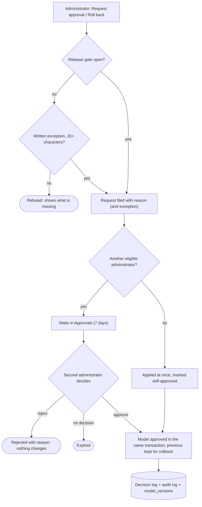

---

## 5. Thresholds (the values that change behaviour)

**Who:** Administrator (requests), a second Administrator (approves). **Trigger:** validation results suggest a better value, or an incident.

The thresholds: review confidence (0.7); the alert rule (250 m², 30 m, 50%); abstention (60% of structures unsure); unusual image (more than 2
statistics outside the training range); blank or cloud (40%); live precision floor (60%) and window (30 alerts); drift ratio (2×); rubber-stamp time (5 s).

**Journey**
1. On **Thresholds** an administrator clicks **Change**, enters the value (must be inside its allowed range) and the reason (what was measured).
2. The change is a request, approved by a second administrator as for models.
3. On approval a **new row** is added (a new version); the old value stays in the history. The database refuses edits and deletions.
4. Every result made afterwards records the version it used (`alert_rule_version` on each alert).

**Decisions:** value inside the allowed range (else refused); reason ≥ 10 characters; second approver as in section 4.
**Records:** `sem.thresholds` (append-only), `gov.decisions` (kind `threshold`), `audit.log`. **Screens:** Thresholds, Approvals.
**Controls:** A2. **Frameworks:** EU Art. 12, 17; NIST Manage; ISO 42001 A.6.

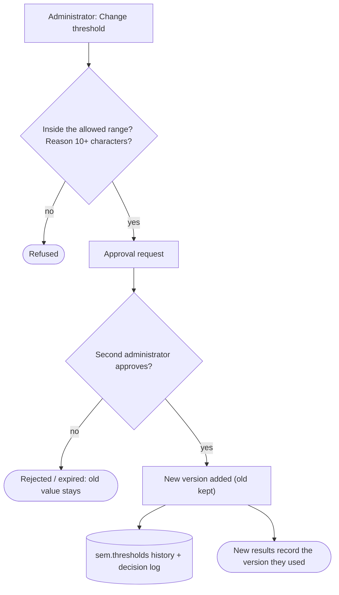

---

## 6. Image intake (upload and alignment)

**Who:** Analyst; System (checks). **Trigger:** imagery of a new event arrives.

**Journey**
1. **Assessments → New upload.** The analyst gives the after image (and the before image, or lets the archive find one), name, hazard type, date.
2. **Rights:** source, licence or agreement, and a tick: "I have the right to process these images". Without all three the upload is refused.
3. **Privacy:** on saving, camera and device metadata (EXIF, XMP, IPTC, text chunks) are removed from JPEG and PNG files without re-encoding; GeoTIFF georeference tags are kept.
4. **Preparation (system):** the images are placed on one grid and aligned automatically; the input checks run: location, resolution, size, before image, capture order, overlap, colour, blank or cloud, unusual image, rights, privacy.
5. **Alignment check (analyst):** swipe, blink or overlay; if needed, tie points; then **Confirm**. The assessment does not start until a person confirms.
6. Uploads are deleted after the retention period, when one is set (`governance/retention.json`).

**Decisions**

| Decision | Rule | Outcome |
| --- | --- | --- |
| Rights given? | Source ≥ 3 characters, licence ≥ 2, confirmation ticked | Otherwise refused (400) |
| Resolution | 0.25–0.9 m/px fine; up to 1.2 m resampled with a warning; > 1.2 m | Fail → the assessment abstains |
| Capture order | An archive before image taken on or after the event date | Fail → abstains |
| Overlap | Before image covers ≥ 90% ok; 25–90% warn (after-only elsewhere); ≤ 25% fail | Fail → assessed from the after image alone |
| Blank or cloud | Share of no-data or cloud > 40% (threshold `blank_max_share`) | Fail → abstains |
| Unusual image | More than 2 of 6 statistics outside the training range (1st–99th percentile of 600 xBD images) | Fail → abstains (about 1 in 100 typical images is flagged) |
| Alignment quality | ≥ 40 matching features within 2.5 px = good; else check or poor | Shown to the analyst, who confirms or fixes |

**Records:** `ingest.uploads` (source, licence, rights_confirmed_by, input_quality, privacy), the alignment file with who confirmed and when, `audit.log` (`upload`, `confirm_alignment`).
**Screens:** Upload dialog, Alignment check, Data register. **Controls:** I1–I5. **Frameworks:** EU Art. 10, 14, 15; ISO 42001 A.7, A.9, A.10; DAMA; OCHA; Pakistan PDP Bill (draft), PECA.

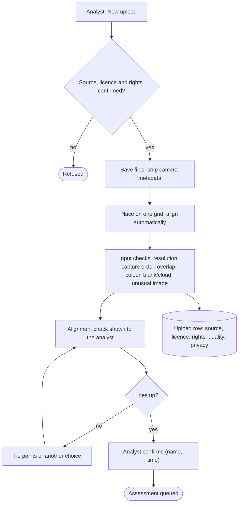

---

## 7. Prediction (assess or abstain)

**Who:** System; the approved model. **Trigger:** a confirmed upload or a benchmark tile is assessed.

**Journey**
1. The approved model grades every pixel; buildings are grouped into structures with a class and a confidence.
2. Structures below the review confidence (0.7) are marked **needs review** (dashed outline).
3. **Abstention:** if an input check failed (section 6), or more than 60% of the structures are below the review confidence, the system **abstains**: no alerts; the would-be alerts are kept as `withheld_alerts`; the screen and the report say **"Not assessed: needs a person"** with the reasons.
4. **Provenance** is stored with the result: input image hashes, model checkpoint hash, training commit, app commit, thresholds and the alert-rule version.

**Decisions**

| Decision | Rule | Outcome |
| --- | --- | --- |
| Input check failed? | Any "fail": coarse imagery, capture order, blank or cloud, unusual image | Abstain (`COARSE_IMAGERY`, `BEFORE_AFTER_EVENT`, `BLANK_OR_CLOUD`, `UNUSUAL_IMAGE`) |
| Model unsure? | Share of structures below 0.7 confidence > 0.6 | Abstain (`LOW_CONFIDENCE`) |
| Structure unsure? | Its confidence < 0.7 | Marked for review |
| Approved model? | The model used is the approved default | Otherwise a warning flag on the result |

**Records:** the assessment record (`provenance`, `gates`, `abstained`, `abstain_reasons`, `withheld_alerts`), `core.assessments` (abstained, reasons, rule version), `audit.log` (`assess`).
**Screens:** Assessment result. **Controls:** P1–P4. **Frameworks:** EU Art. 12–15; NIST Manage; ISO 42001 A.6, A.8, A.9; OECD 1.3, 1.4.

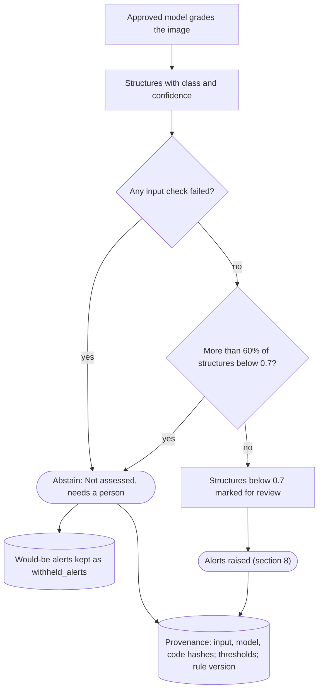

---

## 8. Area alerts

**Who:** System. **Trigger:** an assessment that did not abstain.

**Journey**
1. Severely damaged roof (major or destroyed) within 30 m forms one area.
2. An area with at least 250 m² of severely damaged roof raises an alert; it is **high** when at least 50% of the building area there is severely damaged, otherwise **medium**.
3. Each alert carries the rule text and version, the share of unsure structures in it ("weak evidence: check first" above 50%), and is a **draft**. Nothing is sent anywhere.

**Decisions:** the three rule values above (versioned thresholds). **Records:** alerts in the record and in `core.alerts` (with geometry and rule version).
**Screens:** Assessment result (alert list, map). **Controls:** A1–A3. **Frameworks:** EU Art. 12–14; ISO 42001 A.8; OECD 1.3, 1.5.

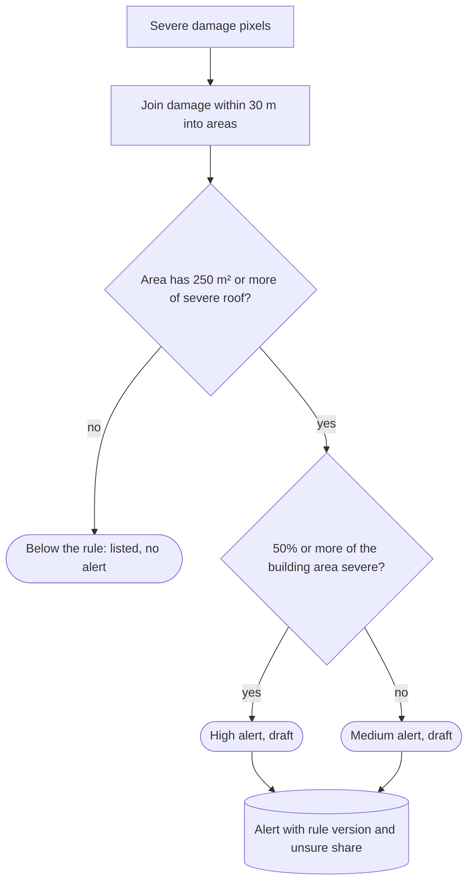

---

## 9. Human review (four-eyes)

**Who:** Analyst, a different Approving officer. **Trigger:** a draft alert.

**Journey**
1. The analyst opens the alert: the map zooms to it; **Evidence** shows before and after crops of its structures.
2. The analyst **proposes** it for confirmation, asks for **more information**, or **dismisses** it (a reason is required).
3. A **different** approving officer **confirms** the proposal or **returns** it to draft (reason required). The database refuses a confirmation by the proposer.
4. A confirmed alert can be **retracted** by an officer with a reason; this automatically opens an incident (section 12).
5. For every decision the screen reports how many seconds it took and whether the evidence was opened.
6. Every 3 months reviewers take the **oversight test**: planted false alerts among real ones; they must catch at least 80%.

**Decisions**

| Decision | Rule | Outcome |
| --- | --- | --- |
| Dismiss or retract without a reason? | Reason empty | Refused (application and database) |
| Confirmer is the proposer? | Same person | Refused (database rule `four_eyes`) |
| Confirm without a proposal? | Status is not "proposed" | Refused |
| Possible rubber stamp? | Confirmed in under 5 s, or without opening the evidence | Counted on Monitoring; more than half of ≥ 10 measured confirmations → incident |
| Oversight test passed? | ≥ 80% of planted errors caught, ≤ 10% of true alerts dismissed | Recorded in `governance/records/oversight_test_<date>.md`; a miss means retraining of reviewers |

**Records:** `wf.alert_reviews`, `wf.alert_review_events` (append-only, with seconds and evidence viewed), `audit.log` (`review`).
**Screens:** Assessment result (review card), Monitoring (review behaviour). **Controls:** H1–H4, A1. **Frameworks:** EU Art. 14; NIST Manage, Measure; ISO 42001 A.9.

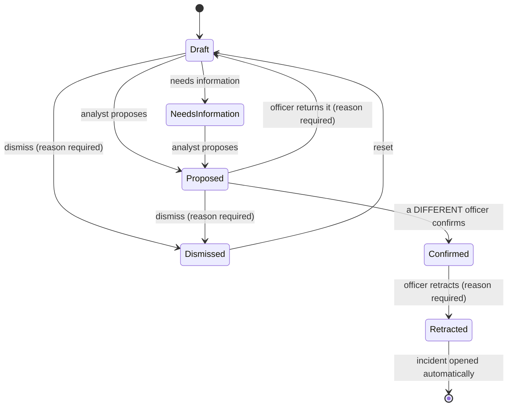

---

## 10. Export and reports

**Who:** Approving officer. **Trigger:** confirmed alerts must reach the field team.

**Journey**
1. The officer downloads GeoJSON, CSV or the situation report (HTML or Markdown).
2. Every file carries the draft marker for unconfirmed alerts, the model version, the input and checkpoint hashes, the rule version and the limits text ("not for dispatch, safety or routing decisions").
3. Every download is an `export` row in the audit log. Analysts and auditors cannot export or open reports.
4. People see and export only their own unit's work and the units below it.

**Decisions:** holds the `export` permission (route policy) → allowed; otherwise 403 and a `denied` audit row. Dismissed and retracted alerts are left out unless explicitly included.
**Records:** `audit.log` (`export`, kind). **Screens:** Assessment result (export bar, report buttons). **Controls:** E1–E3, A3. **Frameworks:** EU Art. 12, 13; ISO 42001 A.8; OCHA; PECA.

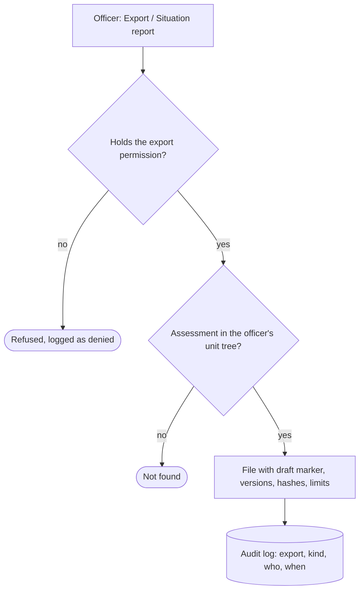

---

## 11. Monitoring

**Who:** System; Administrators, auditors and officers read it. **Trigger:** every start of the application, every opening of the Monitoring page, **Run checks** on Compliance.

**Journey**
1. **Live precision:** of the last 30 decided alerts, the share confirmed (a retraction counts as wrong); overall, per model, per hazard.
2. **Drift:** share of uploads flagged unusual in the last 30 days against the 30 days before.
3. **Abstention:** how often and why the system declined (30 days).
4. **Review behaviour:** possible rubber stamps per reviewer.
5. **Audit chain:** verified from the first entry to the last.
6. Each floor crossed raises **one** incident (a second check adds a note to the open one).

**Decisions**

| Check | Floor | Incident raised |
| --- | --- | --- |
| Live precision | < 60% over the last 30 decided alerts (only once 30 exist) | `model_quality`, high |
| Drift | Unusual share ≥ 2× the previous 30 days (≥ 5 uploads; or ≥ 20% from zero) | `data_drift`, medium |
| Rubber stamps | > 50% of ≥ 10 measured confirmations flagged | `other`, medium |
| Audit chain | Any broken link | `audit_chain`, serious |

**Records:** incidents (`gov.incidents`), the numbers on the page and in the technical file. **Screens:** Monitoring, Incidents. **Controls:** M1, M2, H3, F3.
**Frameworks:** EU Art. 72; NIST Measure, Manage; ISO 42001 Cl. 9.

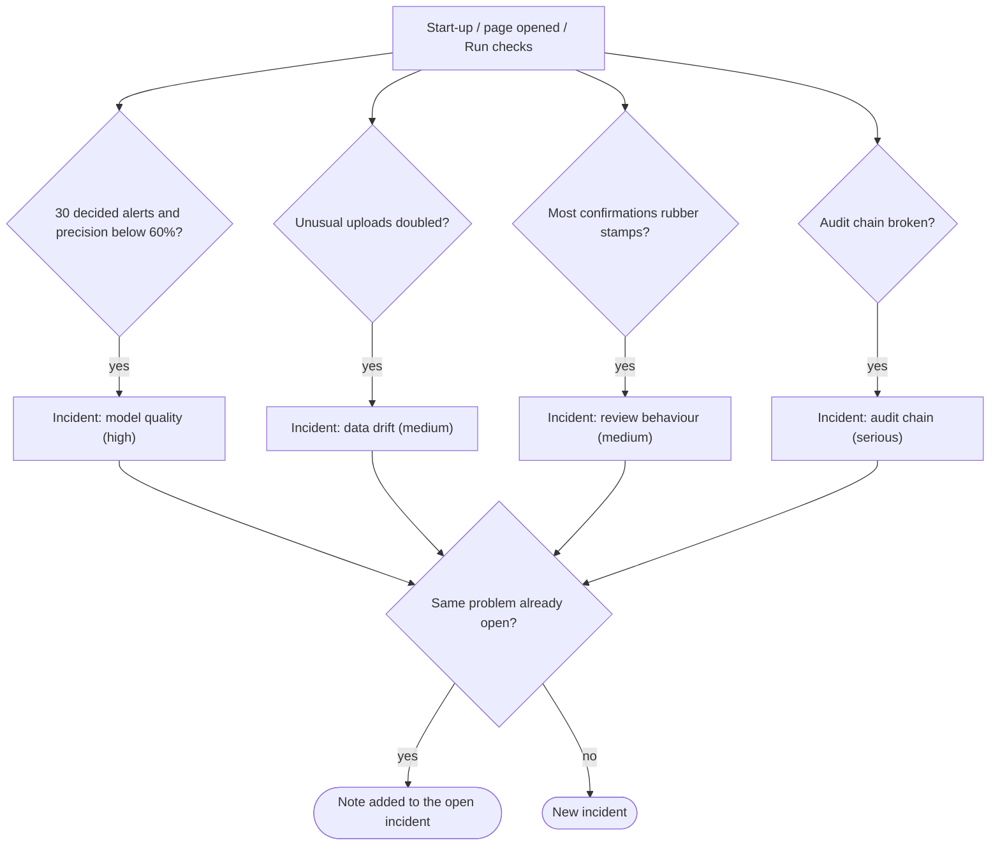

---

## 12. Incidents

**Who:** anyone signed in reports; Administrator or Approving officer assesses and closes; Supervisor for serious ones. **Trigger:** a person reports one, a retraction, or a monitoring check.

**Journey**
1. **Report** (Incidents page or "Report a problem with this alert"): kind, severity, title, what happened; linked to the assessment and alert.
2. A **serious** incident carries the instruction to tell the supervisor within 24 hours and stop using the affected output.
3. **Assess:** what was found; severity may be changed; state becomes *investigating*.
4. **Close** with the **cause** and the **resolution** (both required). A closed incident cannot be changed, only **reopened** with a reason.
5. Nothing is deleted. High and serious incidents should not stay open more than 7 days (control N3).
6. Every 6 months an **incident drill** rehearses a wrong alert from retraction to closure and records the time taken.

**Decisions**

| Decision | Rule | Outcome |
| --- | --- | --- |
| Same check problem already open? | Same dedup key, not closed | Note added, no second incident |
| May close? | Holds `incident_manage`; cause ≥ 5 and resolution ≥ 10 characters | Closed; else refused |
| Serious? | Severity "serious" | Supervisor within 24 hours |
| Open too long? | High or serious open > 7 days | Control N3 not met (Compliance) |

**Records:** `gov.incidents`, `gov.incident_events` (append-only), `audit.log` (`incident_*`), `governance/records/incident_drill_<date>.md`.
**Screens:** Incidents, Assessment result (report link). **Controls:** N1–N4. **Frameworks:** EU Art. 73; NIST Manage; ISO 42001 Cl. 10.

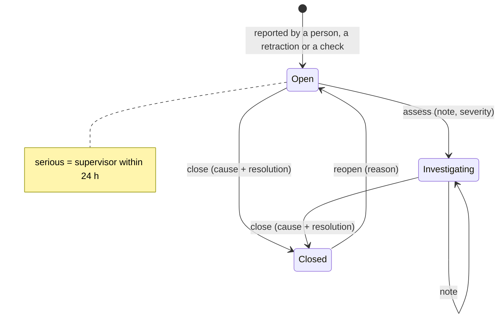

---

## 13. Risk register

**Who:** Administrator edits; Supervisor reviews quarterly. **Trigger:** the review date of a risk, an incident, a new stage or feature.

**Journey:** open **Risk register**; the heat map shows open risks by likelihood × severity; **Edit** a risk (likelihood, severity, controls, owner, status, next review) with a reason (≥ 10 characters); the old and new values go to the audit log. A risk past its review date shows **Overdue** and keeps control G2 unmet.

**Records:** `gov.risks`, `audit.log` (`risk_change`, `risk_added`). **Controls:** G2. **Frameworks:** EU Art. 9; NIST Map, Manage; ISO 42001 Cl. 6, ISO/IEC 23894.

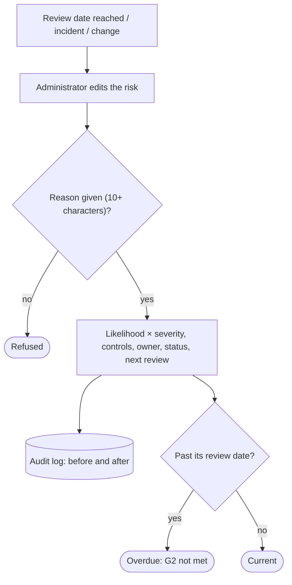

---

## 14. Access: accounts, two-step sign-in, access review

**Who:** Administrator; every user for their own two-step sign-in. **Trigger:** a person joins, changes role or leaves; every 3 months.

**Journey**
1. An administrator creates the account in their own unit tree with a role; the person gets a temporary password and must choose their own.
2. **Two-step sign-in:** Account menu → Two-step sign-in → Set up → add the key to an authenticator app → type the code → on. From then on every sign-in asks for the 6-digit code. Expected for administrators and approving officers.
3. **Access review** every 3 months: for each active account, another administrator clicks **Still needed** or **Disable** (with a reason). Nobody reviews their own account. Disabling ends the sessions at once.
4. Five failed sign-ins lock the name for 5 minutes. Demo accounts with the published password must be off in real use.

**Decisions**

| Decision | Rule | Outcome |
| --- | --- | --- |
| Code needed? | Two-step on for the account | Sign-in asks for it; a wrong code counts as a failed attempt |
| Reviewing yourself? | Reviewer = account | Refused (database rule) |
| Account due? | No review in the last 92 days | Listed as due; control F5 not met |
| Demo accounts on? | `ENVIROSENSE_DEMO_ACCOUNTS` not 0 | Control F7 not met |

**Records:** `iam.users`, `iam.sessions`, `gov.access_reviews` (append-only), `audit.log`. **Screens:** Users, Access review, Account menu, Sign-in.
**Controls:** F1, F2, F4–F7. **Frameworks:** EU Art. 15; ISO 42001 A.3, A.4; DAMA security; PECA 2016.

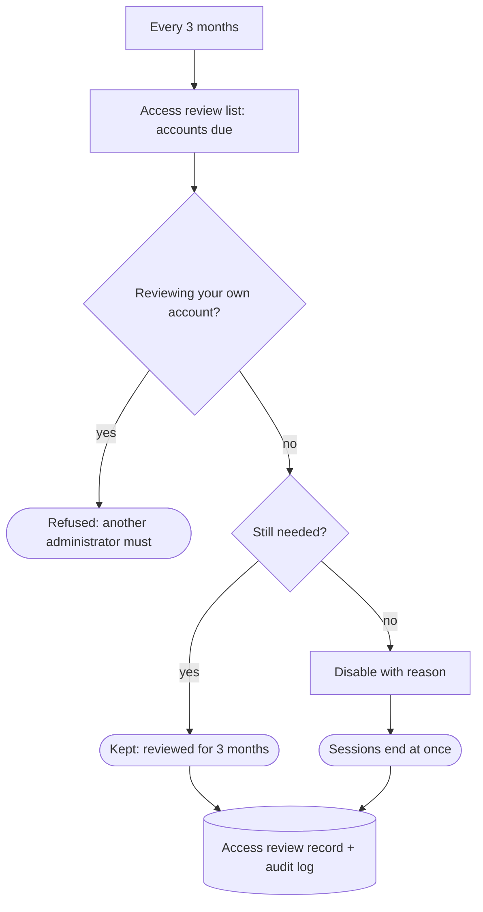

---

## 15. Compliance and audit cycle

**Who:** Auditor and Supervisor; System. **Trigger:** every 3 months (internal audit), and before a release.

**Journey**
1. Run the test suite: every test result is recorded (`runs/app/test_results.json`) as evidence.
2. Open **Compliance → Run checks**: every control's evidence is checked now (tests, live checks, documents, dated records); each control is met, partly met, not met or not measured; each framework is scored from its controls.
3. Download the **technical file**: intended use, the approved model's scorecard and card, every control with its evidence, every framework requirement, monitoring, risks, the decision log, all generated from the records.
4. The auditor verifies the audit chain; the internal audit is written to `governance/records/internal_audit_<date>.md`; findings become incidents, risks or decisions.

**How each framework is applied** (live on the Compliance page):

| Framework | Its role here | How it is applied |
| --- | --- | --- |
| ISO/IEC 42001 (+ 23894, 42005) | The management system | Clauses 4–10 are the governance layer (policy, roles, risk, records, audit, improvement); the control register is the statement of applicability for the Annex A areas |
| NIST AI RMF 1.0 | The working loop | The register read by function (Govern, Map, Measure, Manage) gives the current profile; the target is every function met |
| EU AI Act (benchmark) | Legal checklist for high-risk systems | Each article is the acceptance condition of its controls; the technical file follows Annex IV; Art. 72/73 are monitoring and incidents |
| OECD AI Principles | Values | Each principle points at the controls that carry it; the classification profile is in the impact assessment |
| DAMA-DMBOK, OCHA | Data practice | Checklist for the data controls (quality, metadata, lineage, security, retention, responsible sharing) |
| Pakistan (PECA 2016, PDP Bill draft, National AI Policy 2025) | Legal setting | Access, security, privacy and human oversight controls; status of the texts to confirm |

**Records:** test results, the technical file, internal audit records. **Screens:** Compliance, Audit log. **Controls:** G6, G8, F3, and all others as evidence.

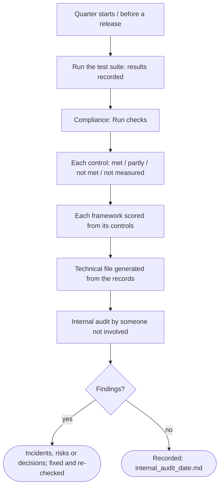
